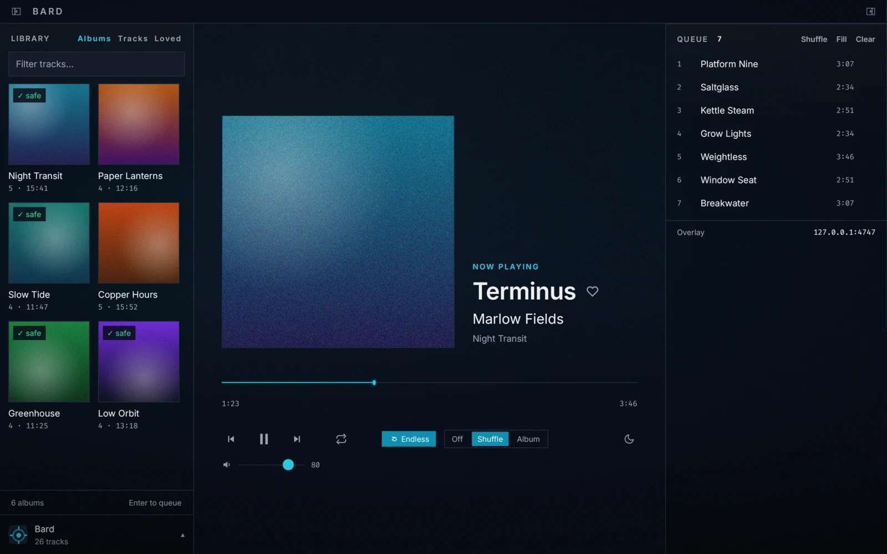

<p align="center"></p>

<h1 align="center">Bard</h1>

<p align="center">A local music player for streamers, built for a curated library of music you
are allowed to play on stream.</p>



Bard plays the files you point it at and nothing else. Nothing is fetched,
streamed or searched for online. That's the whole point: you can leave it
running under a stream without wondering whether the next track is licensed.

## Features

- **Streamer mode.** Mark each album as _safe_, _claimed_ or untested after
  checking it against Content ID. While streamer mode is armed, only safe albums
  play, even ones you pick yourself, and a track that stops being allowed is cut
  at once. It can arm itself when OBS starts streaming, recording, the replay
  buffer or the virtual camera. It never disarms itself.
- **An OBS overlay.** A browser source served on `127.0.0.1` that updates the
  moment the track changes, plus `nowplaying.json` for file-based setups.
- **Its own output device.** Send music to a dedicated stream mix instead of
  your speakers. If the device is missing at startup, Bard uses the default
  and switches over by itself when it appears.
- **Endless playback.** Shuffle or album-by-album fill keeps playing when the
  queue runs dry. Loved tracks come up more often, and claimed albums are left
  out.
- **Even volume.** ReplayGain normalisation by track or album, plus crossfade.
- Plays MP3, FLAC, WAV, Ogg Vorbis, M4A (AAC/ALAC) and Opus.
- Album art, a live visualiser, repeat one/all and a sleep timer.
- Runs on Linux, with experimental support for macOS and Windows.
- On Linux, a tray icon with a now-playing preview, and MPRIS, so desktop
  media controls and media keys work.

## Requirements

- **Linux** with PipeWire, on Wayland or X11. Bard is developed on KDE Plasma
  (Wayland). The tray needs a StatusNotifierItem host, which Plasma provides.
- **macOS** 11 or newer on Apple Silicon (experimental).
- **Windows** 10 or 11, x86_64 (experimental).

The OBS password is kept in the system keyring: a Secret Service provider on
Linux (KWallet, GNOME Keyring or KeePassXC), the Keychain on macOS, and
Credential Manager on Windows.

> [!NOTE]
> **macOS and Windows support is experimental.** Bard is developed and used
> on Linux. The macOS and Windows builds are built and tested in CI, but have
> hardly been used on real machines yet, and there's no tray icon or
> media-key support on either (closing the window quits Bard). If something
> doesn't work, please [open an issue](https://github.com/hammackj/bard/issues)
> with your OS version and what happened.

## Installing

### From a release

[Releases](https://github.com/hammackj/bard/releases) have a Debian package
and a tarball for x86_64 Linux, a zipped app for macOS on Apple Silicon, and a
zip for Windows. The macOS and Windows builds are
[experimental](#requirements).

**Debian / Ubuntu 24.04 or newer:**

```bash
sudo apt install ./bard-player_<version>-1_amd64.deb
```

**Arch Linux:** the repo has a PKGBUILD that packages the release tarball. It
isn't on the AUR yet, so build it from a clone:

```bash
cd packaging/aur/bard-player-bin && makepkg -si
```

**Any other distro:** download `bard-<version>-x86_64-linux.tar.gz`, extract
it, and from inside the folder run:

```bash
install -Dm755 bard ~/.local/bin/bard
./scripts/install-desktop.sh ~/.local/bin/bard
```

That adds a launcher and icons for your user. The binary needs the PipeWire,
Opus and xkbcommon libraries, which most desktops already have.

**macOS:** unzip `bard-<version>-aarch64-macos.zip` and move **Bard** to
Applications. It isn't notarised, so the first time, right-click it and
choose **Open**, or clear the quarantine flag:

```bash
xattr -dr com.apple.quarantine /Applications/Bard.app
```

**Windows:** extract `bard-<version>-x86_64-windows.zip` anywhere and run
`bard.exe`. It isn't code-signed, so SmartScreen may ask first: choose
**More info**, then **Run anyway**.

### From source

You need a stable Rust toolchain from [rustup](https://rustup.rs) and these
development packages:

```bash
# Debian / Ubuntu (24.04 or newer)
sudo apt install build-essential pkg-config clang libclang-dev \
  libpipewire-0.3-dev libspa-0.2-dev libopus-dev libwayland-dev \
  libxkbcommon-dev libxkbcommon-x11-dev libxcb1-dev libfontconfig-dev libfreetype-dev

# Arch
sudo pacman -S --needed base-devel clang libpipewire opus wayland \
  libxkbcommon libxkbcommon-x11 libxcb fontconfig freetype2
```

Then:

```bash
git clone https://github.com/hammackj/bard.git
cd bard
./scripts/install-desktop.sh
```

That builds the release binary, installs it to `~/.local/bin/bard`, and
registers a `.desktop` entry and the icons in your per-user XDG directories.
`--desktop` also puts a launcher on the desktop.

On **macOS** you need the Xcode command line tools and CMake
(`brew install cmake`); on **Windows**, the Visual Studio C++ build tools and
CMake. Then `cargo build --release -p bard` gives you `target/release/bard`
(`bard.exe` on Windows). There's no install script for either yet.

Run it again after pulling to update; `cargo build` alone doesn't touch the
copy your launcher runs. Every build records its commit, shown next to the
version in Settings → About and the avatar menu, with `-dirty` if it was built
from uncommitted changes.

## Getting started

1. Launch Bard and click **Choose a music folder**. Tags and embedded art are
   read once and cached.
2. Open **Settings** (`Ctrl+,`, or `Cmd+,` on macOS) to set the output device, normalisation,
   crossfade and streamer mode.

### The OBS overlay

Settings shows the overlay URL, normally `http://127.0.0.1:4747`. In OBS, add
a **Browser Source** with that URL, about 470×210. If port 4747 is taken, Bard
tries the next one up, so use the **Copy** button instead of assuming 4747.

The server only listens on `127.0.0.1`. It's for the OBS on this machine;
exposing it would put your library and its artwork on the network. Most
royalty-free catalogues allow use _within_ a stream but not redistributing the
audio, and keeping the overlay local helps you stay inside that.

`nowplaying.json` is written to Bard's data folder (`~/.config/bard` on
Linux, `~/Library/Application Support/bard` on macOS, `%APPDATA%\bard` on
Windows), atomically, whenever the
track, play state or queue length changes. It isn't rewritten on every
progress tick. You can turn it off in Settings.

### Streamer mode

1. Check your albums. `scripts/make-album-videos.sh` renders one video per
   album (its cover over the whole album's audio) with a chapter list. Upload
   it to YouTube as private, and any Content ID claim's timestamp points to
   the exact track.
2. Mark each album **safe** or **claimed** from its page in the library.
   Claimed albums are kept out of shuffle, fill and endless.
3. Arm it in Settings → Streamer mode (**Only play albums marked safe**), or
   turn on **Arm automatically when OBS goes live** and give Bard the OBS
   WebSocket address and password. The password is stored in your system
   keyring. While armed, a green banner says so; turn it off from there.

While armed, untested albums are blocked too: an album nobody has checked
isn't evidence of anything. Blocked tracks always say why instead of failing
silently.

### Shortcuts

| Key           | Action                   |
| ------------- | ------------------------ |
| `Space`       | Play / pause             |
| `←` `→`       | Seek ±5s                 |
| `↑` `↓`       | Volume                   |
| `/`           | Focus the library filter |
| `Enter`       | Queue the selected track |
| `Shift+Enter` | Play it now              |
| `Ctrl+,`      | Settings (`Cmd+,` on Mac) |
| `?`           | Shortcut list            |

Global media keys are **off by default**: once Bard takes them, they stop
reaching every other player on your machine. Turn them on in Settings.

## Development

```bash
cargo run -p bard            # debug build
cargo run --release -p bard  # release build
cargo test --workspace
```

Formatting, lints and tests must pass before committing, and CI runs the same
checks on every push and pull request (`rustfmt.toml` holds the formatter
settings). See [`CONTRIBUTING.md`](CONTRIBUTING.md).

```bash
cargo fmt --all -- --check
cargo clippy --workspace --all-targets -- -D warnings
```

| Crate           | What it holds                                                   |
| --------------- | --------------------------------------------------------------- |
| `bard-core`     | types, library scan, queue, config and stores                   |
| `bard-audio`    | decoding, PipeWire output, gain, fades, the visualiser analyser |
| `bard-services` | overlay server, `nowplaying.json`, OBS, MPRIS, tray, keyring    |
| `bard`          | the GPUI app: windows, views, and the glue between the above    |

Design decisions to know before changing things:

- **The core owns the queue.** The window sends requests and renders what
  comes back, so there is one source of truth for what plays next.
- **Views never touch the core or the audio engine directly.** They read a
  model and call a `Backend` trait, which is what lets the snapshot tool
  render the real views from sample data.
- **Closing the window hides Bard to the tray.** GPUI can't hide a window on
  Linux, so it really closes; its state is kept and a new window is built
  when the tray asks for one.

Useful tools:

- `BARD_DATA_DIR=/some/dir` uses that data directory instead of
  `~/.config/bard`, with its own MPRIS name and keyring entry, so a dev build
  can run next to the installed one without touching its library or stats.
- `cargo run -p bard --features snapshot --bin bard-snapshot` renders the
  real views headlessly to PNG from a fixture file.
- `./scripts/screenshot.sh` regenerates `resources/screenshot.webp` from an
  invented library.
- `scripts/replaygain.py` writes the ReplayGain tags that normalisation uses.

### Releases

The workspace version in `Cargo.toml` is the single source of truth. Add the
release to `CHANGELOG.md`, bump the version, and commit both together so the
tag points at the release:

```bash
git commit -am "Bard 0.2.1"
git tag -a v0.2.1 -m "Bard 0.2.1"
git push origin master v0.2.1
```

Bard is on a `0.x` line: minor versions may carry breaking changes, patch
versions don't.

## Built with Claude

Bard was written with a lot of help from
[Claude Code](https://claude.com/claude-code), Anthropic's coding agent. That
covers the original Electron app, the port to Rust and GPUI, and most of the
bug fixes since. The maintainer sets the design and features, and decides
what ships in each release.

Most bug reports came from code reviews filed as tickets. Each fix comes with
a test that reproduces the bug and fails without it. Everything has to pass
the same checks before it is committed: the test suite, `cargo clippy` with
warnings as errors, and `cargo fmt`. Commits don't carry AI co-author
trailers; this section is the disclosure instead.

## Licence

Bard's code is MIT-licensed; see [`LICENSE`](LICENSE). The bundled fonts
(Inter, Fira Code) are under the SIL Open Font License, and two icons are
adapted from Feather (MIT); see [`THIRD-PARTY.md`](THIRD-PARTY.md).

Bard doesn't supply or relicense any audio. The music you play is covered by
its own licence.
